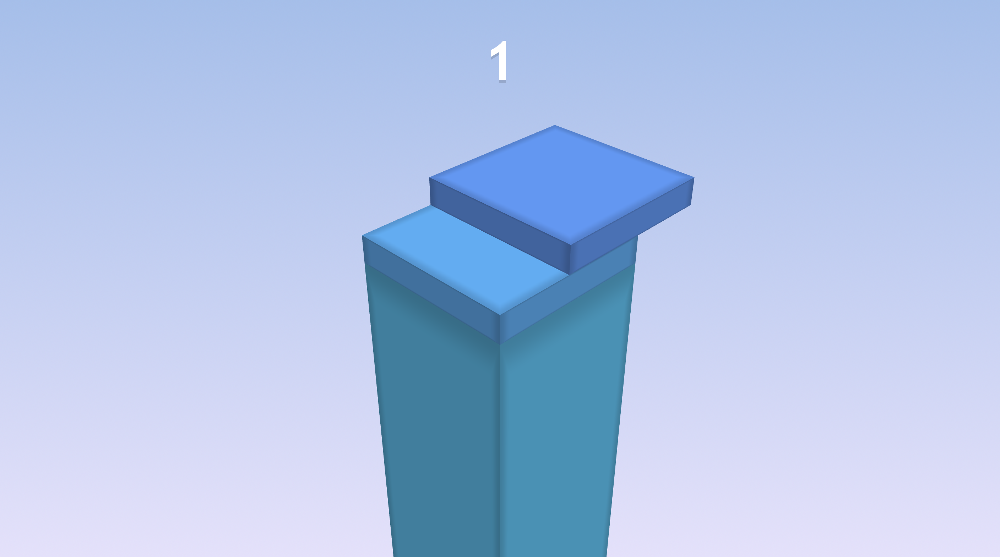

<div align="center">

# Stratum

<p align="center">
  <b>A Precision 3D Tower-Stacking Game Built from Scratch in Hand-Written WebGL2</b>
</p>

<p align="center">
  <a href="https://nowii-core.github.io/stratum-game/">
    
  </a>
  <a href="https://github.com/nowii-core/stratum-game/blob/main/LICENSE">
    
  </a>
  
  
  
</p>

<p align="center">
  <a href="https://nowii-core.github.io/stratum-game/">Live Demo</a> |
  <a href="#overview">Overview</a> |
  <a href="#preview">Preview</a> |
  <a href="#key-features">Features</a> |
  <a href="#tech-stack">Tech Stack</a> |
  <a href="#project-architecture">Architecture</a> |
  <a href="#quick-start">Quick Start</a> |
  <a href="#contact--support">Contact</a>
</p>

---

</div>

## Overview

**Stratum** is a precision 3D arcade stacking game engineered from scratch in hand-written **WebGL2** with **zero external dependencies**. Stack moving 3D blocks one atop another, slice away any overhanging edges, and build the tallest possible tower.

Every mistimed drop shears off the protruding section and narrows the active block, raising the stakes as your tower climbs higher. Land near-perfect placements to snap blocks back into alignment, or chain **3 consecutive perfect drops** to expand the block width back out. Everything runs natively in the browser from static files—no bundler, no server, no build tools required.

---

## Preview

<a href="https://nowii-core.github.io/stratum-game/"></a>

> **Live Demo:** [**nowii-core.github.io/stratum-game/**](https://nowii-core.github.io/stratum-game/)

---

## Key Features

- **Precision 3D Stacking:** Drop moving blocks with pinpoint timing to build the tallest tower possible.
- **Dynamic Overhang Slicing:** Any misaligned portion breaks off and falls away, progressively shrinking the next block.
- **Snap Alignment & Combo Recovery:** Near-perfect drops snap cleanly into alignment, while chaining **3 consecutive perfect placements** expands the block back out.
- **Persistent High Score:** Automatically saves your personal best score locally in the browser (`localStorage`).
- **Custom WebGL2 Renderer:** Built entirely from scratch without Three.js or external 3D libraries.
- **Zero Dependencies:** Pure vanilla JavaScript, HTML5, and CSS3—just open `index.html` or play live on [GitHub Pages](https://nowii-core.github.io/stratum-game/).

---

## Tech Stack

### Frontend & Rendering
- **HTML5 & CSS3:** Minimalist HUD, responsive layout, and overlay styling.
- **JavaScript (ES6+):** Core game loop, slicing math, combo tracking, and local score persistence.
- **WebGL 2.0:** Hand-written 3D rendering pipeline and shaders with zero external frameworks.

---

## Project Architecture

```text
stratum-game/
├── index.html          # Main entry point and WebGL2 canvas container
├── style.css           # HUD, typography, and responsive layout styles
├── game.js             # Custom WebGL2 engine, slicing logic, combos & game loop
├── preview.png         # Gameplay preview image
└── README.md           # Project documentation
```

---

## Quick Start

### Play Online
Open the **[Live Demo](https://nowii-core.github.io/stratum-game/)** directly in your browser.

### Run Locally
Simply **double-click `index.html`** in any modern browser. No installation, no bundler, and no local server required.

### Controls
- **`Space` / Click / Tap:** Stop and lock the moving block in place

---

## License

This project is distributed under the **MIT** license. See the [`LICENSE`](./LICENSE) file for more information.

---

## Contact & Support

- **Maintainer:** [@nowii-core](https://github.com/nowii-core)
- **Bug Reports & Feature Requests:** If you encounter an issue or would like to suggest an improvement, open an [Issue](https://github.com/nowii-core/stratum-game/issues) or submit a [Pull Request](https://github.com/nowii-core/stratum-game/pulls).

---

<div align="center">
  <sub>Developed by <b>nowii-core</b></sub>
</div>
